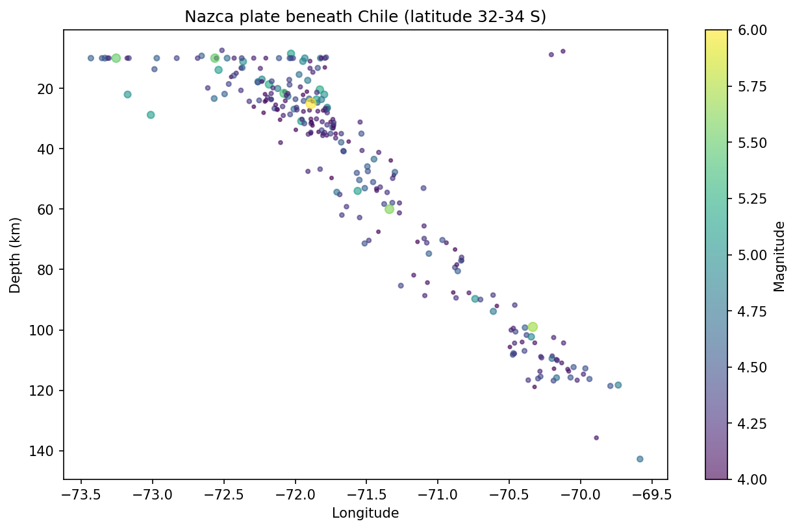
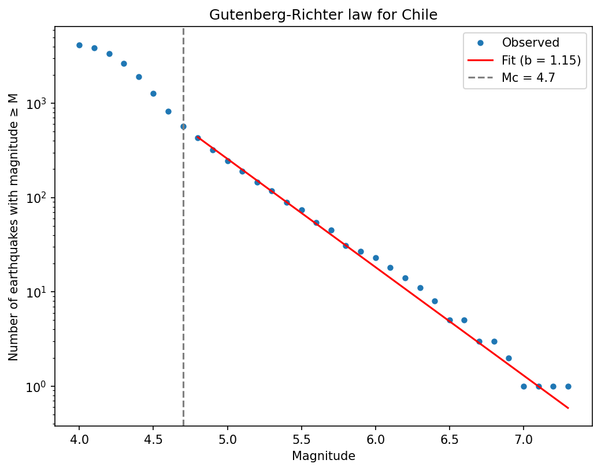
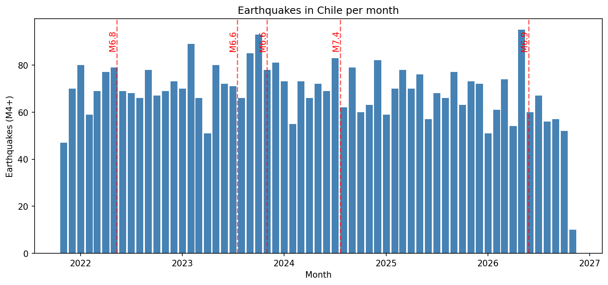
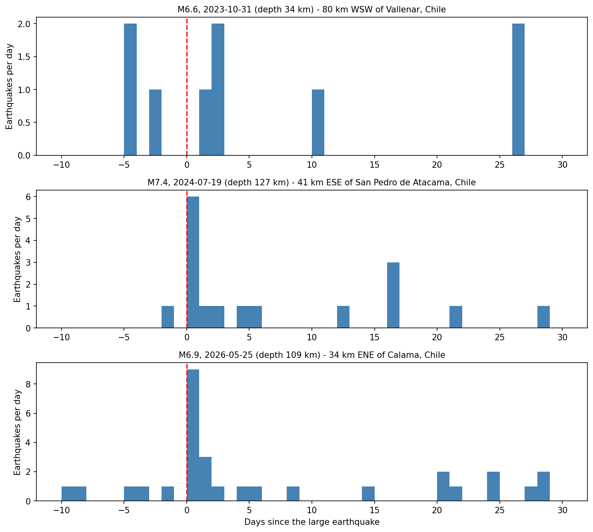

# Earthquakes in Chile

An analysis of earthquakes in Chile using open USGS data, where the Nazca plate is pushed beneath South America. The project combines programming (data fetching, cleaning, maps, statistics) with geoscience (plate tectonics and seismology).

I started this as a vegetation-change project for Trondheim ("Land-Trend"). While I was working on it during my exchange in Chile, a small earthquake suddenly hit, and it made me want to switch topics.

## Results

### Subduction zone
Depth against longitude for earthquakes around Valparaíso. The line from shallow (coast) to deep (east) is the Nazca plate sinking beneath the continent.

### Gutenberg-Richter law
Each step up in magnitude gives roughly 12 times fewer earthquakes (b-value about 1.08, completeness magnitude Mc = 4.7). Mc was chosen by checking where the b-value stabilises (`src/b_value_check.py`), because the simple automatic estimate gave a misleadingly high b of 1.48.

### Earthquakes per month
Activity is steady at roughly 50 to 95 M4+ earthquakes per month, with the largest events marked.

### Aftershocks
Daily earthquake counts within 150 km of the three largest Chilean earthquakes (M6.5+). The two deep events (127 km and 109 km) show a clear peak on day 0. With only three events this is an observation, not a conclusion.

### Map
`src/main.py` generates an interactive Folium map (`maps/map.html`) with size by magnitude, colour by depth, and Valparaíso marked with the number of earthquakes within 100 km over the last year. Open the file in a browser.

## Data and method

- Source: USGS Earthquake Catalog, M4+, the last 5 years
- The bounding box also covers Argentina, Peru and Bolivia, so I keep only events whose place name contains "Chile" (about 36 % of the raw data was outside Chile)
- Python with pandas, NumPy, matplotlib and Folium

## Project structure

    data/   Downloaded data (CSV)
    docs/   Figures
    maps/   Generated maps (HTML)
    src/    Python scripts

## Run it

    python -m venv .venv
    source .venv/bin/activate
    pip install -r requirements.txt

    python src/fetch_earthquakes.py   # download data
    python src/main.py                # map
    python src/cross_section.py       # subduction zone
    python src/b_value_check.py       # b-value for different Mc
    python src/gutenberg_richter.py   # Gutenberg-Richter plot
    python src/time_series.py         # earthquakes per month
    python src/aftershocks.py         # aftershocks

## Limitations

- USGS mixes magnitude types, and the catalogue is only reliably complete above about M4.7 for Chile
- The Chile filter is based on place names, so a few events near the border may be misclassified
- Aftershocks are based on three events only

## Possible next steps

- Compare with Norway, a stable continental region
- Turn the project into an interactive web app (for example with Streamlit)
